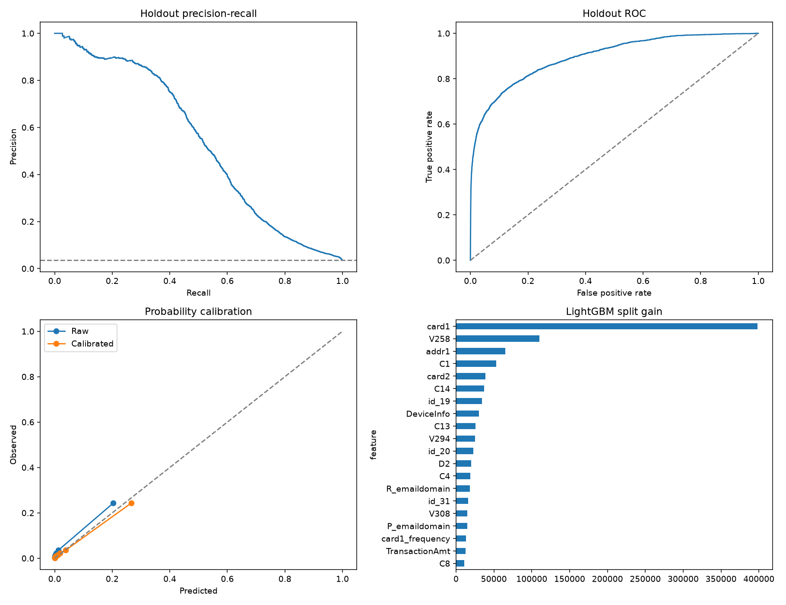
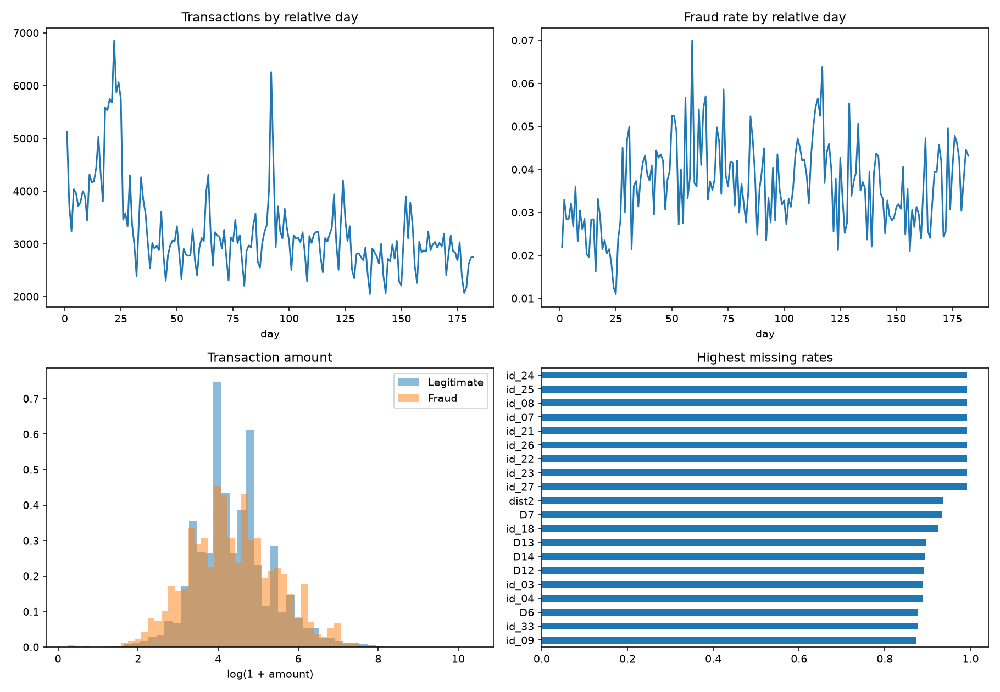

# Kết quả chạy toàn bộ dữ liệu

Chạy ngày 17/11/2026 với `configs/default.yaml`, seed 42 và Python 3.14.4. Đã hoàn tất xử lý 590.540 giao dịch có nhãn và dự đoán 506.691 giao dịch test.

## Dữ liệu và chia tập

Sau left join identity, train có 434 cột, tỷ lệ fraud 3,499% và khoảng 45,07% ô thiếu dữ liệu. Không có TransactionID trùng. Dữ liệu raw được giữ nguyên.

| Tập | Số dòng | Ngày tương đối | Tỷ lệ fraud |
| --- | ---: | --- | ---: |
| train | 356,216 | 1–101 | 3.380% |
| tuning | 88,957 | 102–130 | 4.037% |
| calibration | 59,937 | 131–152 | 3.402% |
| holdout | 85,430 | 153–182 | 3.505% |

Hai cấu hình LightGBM được so sánh bằng average precision trên tuning. Cấu hình được chọn có 63 leaves, 591 cây và tuning AP 0.6314. Mô hình được refit trên 445.173 dòng train + tuning. Calibration và holdout không tham gia fit mô hình gốc.

## Đánh giá holdout

| Mô hình | Average precision | ROC-AUC | Log loss | Brier score |
| --- | ---: | ---: | ---: | ---: |
| prior_baseline | 0.0350 | 0.5000 | 0.1519 | 0.03382 |
| logistic_baseline | 0.1940 | 0.7607 | 0.1321 | 0.03119 |
| lightgbm_raw | 0.5384 | 0.8966 | 0.1026 | 0.02228 |
| lightgbm_calibrated | 0.5384 | 0.8966 | 0.0930 | 0.02197 |

Sigmoid calibration cải thiện log loss và Brier score trên holdout. AP và ROC-AUC giữ nguyên vì phép hiệu chỉnh trong run này bảo toàn thứ tự điểm số.

## Review với quota online

Ngưỡng được khóa từ calibration: **0.683876**. Mỗi giao dịch chỉ được review nếu vượt ngưỡng và còn quota tích lũy trong ngày.

- Review 670/85,430 giao dịch (0.784%).
- Trong review có 559 fraud; precision 83.43%; recall 18.67%.
- Với sensitivity review 80%, số fraud kỳ vọng được ngăn chặn là 447.2.
- Chi phí không review: $299,400; khi review: $255,350.
- Tiết kiệm kỳ vọng: $44,050 (14.71%).

Các giá trị tiền là mô phỏng theo giả định $100/fraud, $1/review, sensitivity 80%; không phải số tiền tiết kiệm đã được xác nhận trong vận hành. Không automatic blocking.

Baseline logistic có tiết kiệm kỳ vọng $17,596. Benchmark daily top-k hồi cứu có tiết kiệm $55,082; benchmark này sử dụng toàn bộ điểm số trong ngày nên không phải kết quả online.

## Kiểm chứng và giới hạn

- 13 kiểm thử pass; Ruff lint và format pass; môi trường không có dependency conflict.
- Smoke test trên 50.000 dòng và run đầy đủ đều hoàn tất.
- Đã kiểm tra quota ở mọi prefix của từng ngày trên holdout và test, không có vi phạm.
- Submission có đúng 506.691 ID theo thứ tự sample_submission; xác suất hữu hạn trong [0, 1].
- Test có 3.515 giao dịch được chọn review. Không có nhãn test nên chưa đo precision/recall trên test.
- PSI của các feature được theo dõi đều dưới 0.2; điều này không chứng minh chất lượng mô hình không đổi.
- AP tuning và holdout khác nhau; đây là các giai đoạn khác nhau và mô hình holdout đã được refit. Cần theo dõi performance khi có nhãn mới, không sửa ngưỡng dựa trên holdout.
- Cần xác nhận tính sẵn có của feature ẩn danh tại thời điểm giao dịch, độ trễ nhãn và thời gian xử lý review trước khi triển khai.

## Artifacts

- [Model card đầy đủ](../artifacts/full/model_card.md)
- [Metrics](../artifacts/full/metrics.json)
- [Submission](../artifacts/full/submission.csv)
- [Metadata và hash của run](../artifacts/full/run.json)
- [Hướng dẫn chạy](../README.md)

